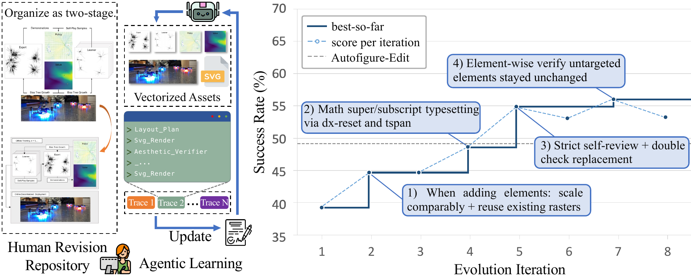
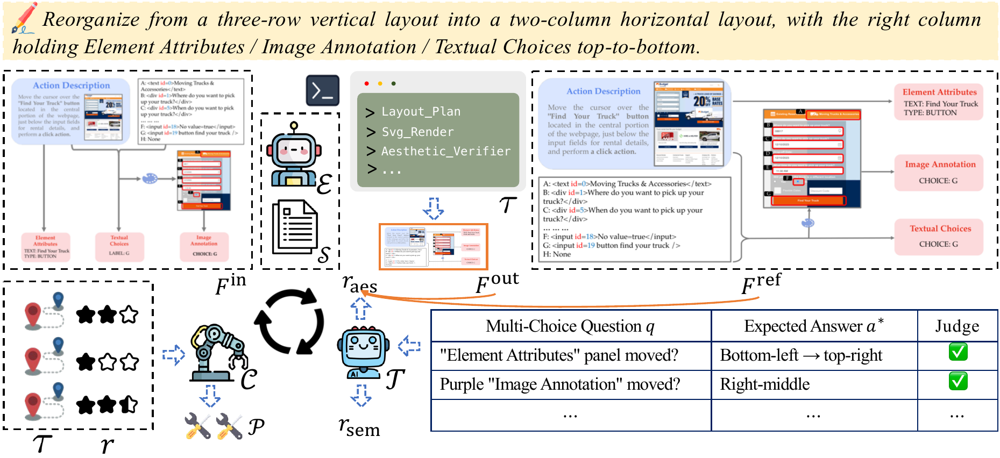

<h1 align="center">SciDiagramEdit: Learning to Edit Scientific Diagrams from Paper Revisions</h1>

<p align="center">
  <a href="https://scholar.google.com/citations?user=Vrq1yOEAAAAJ">Yasheng Sun</a><sup>1</sup> ·
  Zezi Zeng<sup>2</sup> ·
  <a href="https://www.microsoft.com/en-us/research/people/yifanyang/">Yifan Yang</a><sup>2†</sup> ·
  <a href="https://www.microsoft.com/en-us/research/people/cluo/">Chong Luo</a><sup>2</sup> ·
  <a href="https://scholar.google.com/citations?user=79ODhuQAAAAJ">Wenyi Wang</a><sup>1</sup> ·
  <a href="https://liuziwei7.github.io/">Ziwei Liu</a><sup>3</sup> ·
  <a href="https://people.idsia.ch/~juergen/">Jürgen Schmidhuber</a><sup>1</sup>
  <br>
  <sup>1</sup>KAUST · <sup>2</sup>Microsoft Research · <sup>3</sup>Nanyang Technological University
  <br>
  <sup>†</sup>Corresponding author
</p>

<p align="center">
  <a href="https://arxiv.org/abs/2607.15272"></a>
  <a href="https://sunyasheng.github.io/projects/SciDiagramEdit"></a>
  <a href="https://huggingface.co/datasets/yashengsun/SciDiagramRevision"></a>
  <a href="https://huggingface.co/papers/2607.15272"></a>
</p>

<p align="center">
  
</p>

**Left:** the Human Revision Repository, before/after figure pairs mined from arXiv paper revisions. **Middle:** Agentic Learning via Skill Evolution. An SVG-editing agent edits the source figure, and its execution traces are distilled into an evolving skill specification. **Right:** success rate over evolution iterations on a held-out validation split.

## Abstract

Editing the figures in a research paper is a routine and time-consuming part of everyday research practice: authors relabel components, rearrange panels, and restyle visuals as they revise their manuscripts. Automating this editing workflow under a natural-language instruction, however, is challenging, because a scientific figure is a dense infographic in which heterogeneous visual elements such as schematics, plots, photos, captions, and arrows are composed under a tight visual grammar to advance a specific argument. To address this, we present **SciDiagramEdit**, a benchmark and skill-evolution framework that learns from natural paper revisions and operates on the figure's editable vector source, where users can inspect and co-edit individual primitives alongside the agent. Our benchmark mines before/after figure pairs from arXiv version histories, each grounded in the authors' own revision intent. To accommodate the diversity of editing instructions, we adopt *agentic learning via skill evolution*: an agentic proposer continually refines the agent's skill specification from execution traces over multiple epochs. Experiments show that the agent learns meaningful editing skills from paper revisions and substantially improves edit quality over strong single-pass baselines.

## Method

<p align="center">
  
</p>

The **Editor** uses the current skill specification to edit the input figure under a natural-language instruction and records an execution trace. The **Judge** scores the output by an aesthetic comparison against the author's revision and by a per-sample multiple-choice checklist. The **Coach** reads the trace, the scores and the author's revision, and emits a patch that updates the skill specification. The loop iterates over training minibatches with validation gating.

## Benchmark data

[SciDiagramRevision](https://huggingface.co/datasets/yashengsun/SciDiagramRevision) holds 375 editing tasks in its test split. Each task pairs a figure from one version of an arXiv paper with the same figure after the authors revised it. A task contains the editable SVG source before the revision, renders before and after, a natural-language instruction and a grading checklist.

```python
from datasets import load_dataset

ds = load_dataset("yashengsun/SciDiagramRevision", split="test")
row = ds[0]
row["instruction"], row["input_svg"], row["checklist"]
```

The figures come from arXiv submissions and remain under the licence of each source paper.

## Citation

If you find SciDiagramEdit useful, please cite:

```bibtex
@article{sun2026scidiagramedit,
  title   = {SciDiagramEdit: Learning to Edit Scientific Diagrams from Paper Revisions},
  author  = {Sun, Yasheng and Zeng, Zezi and Yang, Yifan and Luo, Chong and
             Wang, Wenyi and Liu, Ziwei and Schmidhuber, J\"urgen},
  journal = {arXiv preprint arXiv:2607.15272},
  year    = {2026},
  url     = {https://arxiv.org/abs/2607.15272}
}
```
